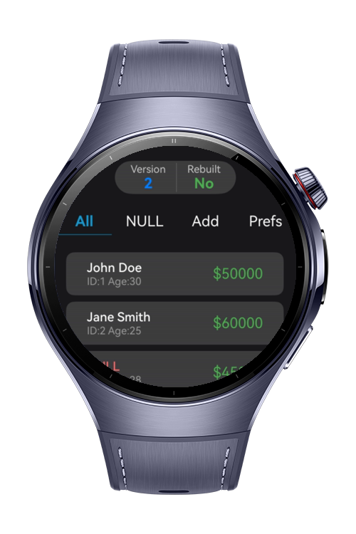
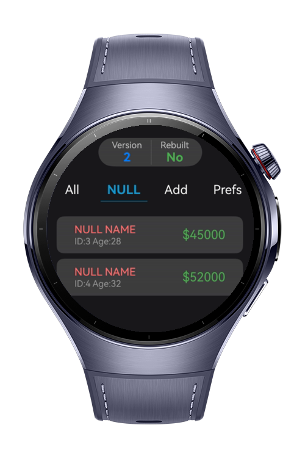
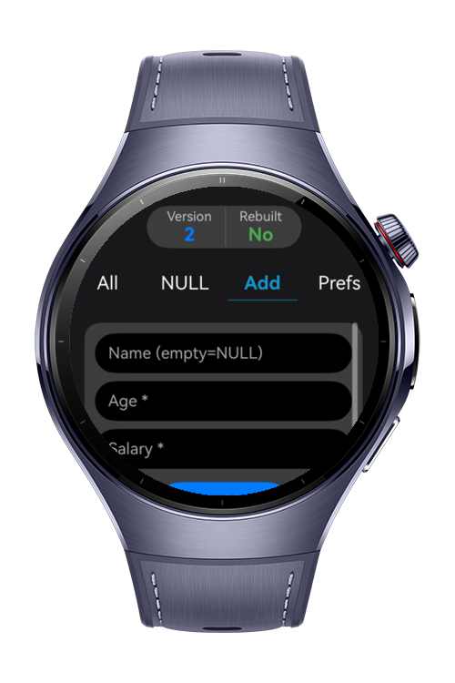
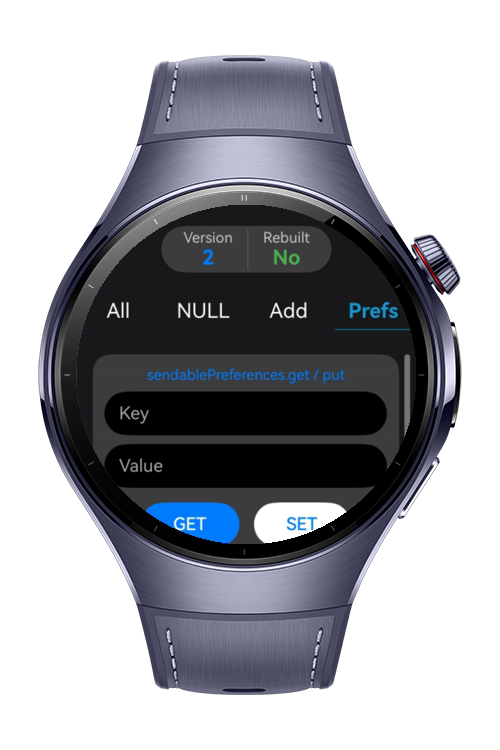

> **Note:** To access all shared projects, get information about environment setup, and view other guides, please visit [Explore-In-HMOS-Wearable Index](https://github.com/Explore-In-HMOS-Wearable/hmos-index).

# How to Build Network Firewall Tester on Watch

Network Firewall Tester on Watch is a wearable sample app that demonstrates how to use ArkData (RDB) in ArkTS. It stores, retrieves, and processes firewall test results while showcasing database operations such as data persistence, null safety handling, and asset conversion within a smartwatch environment.

# Preview

<div>
  
  
  
  
</div>

# Use Cases
* **Local Data Persistence Demo**
  Shows how to create and access a database using .getRdbStore and store firewall test results.
* **Data Retrieval & Querying**
  Demonstrates fetching saved records with .get and displaying them on a wearable UI.
* **Null Safety Handling**
  Uses .isNull to safely manage missing or incomplete database fields.
* **Data Transformation for Sharing**
  Converts stored records into transferable objects using .toSendableAsset. 
* **Structured Data Flow in Wearables**
  Illustrates how data flows from test execution → storage → UI → export. 
* **Real-world Scenario Simulation**
  Uses firewall testing as a practical example to make database operations more meaningful.

# Technology

## Stack
**Languages**: ArkTS

**Frameworks**: HarmonyOS SDK 5.1.0(18)

**Tools**: DevEco Studio Vers 5.1.0.842

**Libraries**:
* `@kit.ArkData`
* `@kit.ArkUI`
* `@kit.AbilityKit`
* `@kit.BasicServicesKit`

# Directory Structure
```
├── database
│   ├── DatabaseHelper.ets
│   └── SendablePreferenceHelper.ets
├── entryability
│   └── EntryAbility.ets
├── model
│   └── Employee.ets
└── pages
    └── Index.ets
```
# Constraints and Restrictions

## Supported Device
- Huawei Watch 5

# License

How to Build Network Firewall Tester on Watch is distributed under the terms of the MIT License.

See the [LICENSE](./LICENSE) for more information.